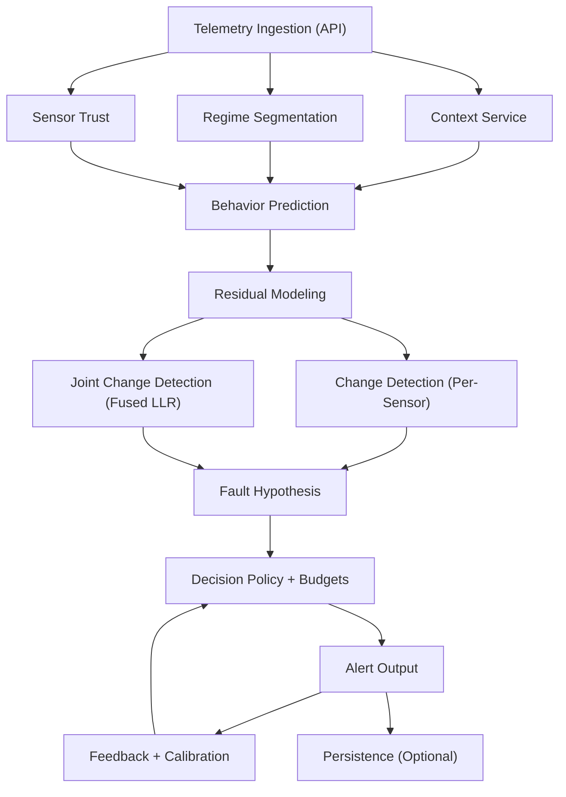

# Predictive Maintenance System Architecture

## Overview
This application is a radar‑inspired predictive maintenance (PdM) system for HVAC/R assets. It ingests telemetry, segments operating regimes, evaluates sensor trust, models expected behavior, detects persistent deviations, generates probabilistic fault hypotheses, and enforces an explicit false‑positive budget before issuing alerts. A calibration loop uses technician feedback to adjust false‑alarm probabilities over time.

The primary entry point is the integrated system in `integration/advanced_system.py`, with a public HTTP API in `api/` and optional persistence in `persistence/`.

## Design Goals (Non‑Negotiable)
- Fixed false‑positive budget before modeling.
- Persistent, regime‑aware change detection on residuals rather than point anomalies.
- Clear separation of concerns.
- Sensor integrity does not imply equipment health.
- Anomaly detection is not the same as fault diagnosis.
- Operator‑facing alerts include probability, evidence, and recommended action.

## Key Components

### API Layer
- `api/routes.py` exposes endpoints for telemetry ingestion, system status, alert listing, and metrics.
- `api/schemas.py` defines request and response models, including alert payloads and metrics.

### Integrated System
- `integration/advanced_system.py` implements the end‑to‑end pipeline in `HVACRPdMAdvancedSystem`.
- It orchestrates all services in the correct order and returns `PDMAlert` outputs.

### Core Services
- `services/regime_service.py` performs regime segmentation using deterministic rules with optional HMM‑style smoothing for validation.
- `services/sensor_trust_service.py` computes sensor integrity scores and gates downstream analysis.
- `services/behavior_service.py` or `services/residual_service.py` predicts expected values and models residual distributions with heavy‑tail and autocorrelation handling.
- `services/change_detection_service.py` runs per‑sensor sequential change detection using CUSUM and GLR, plus joint fused‑LLR detection across sensors.
- `services/fault_hypothesis_service.py` converts symptom evidence into a probabilistic fault belief distribution.
- `services/decision_policy_service.py` enforces false‑positive budgets and decides between WATCH, SENSOR_INTEGRITY, or ACTIONABLE alerts.
- `services/fingerprint_service.py` performs hierarchical modeling (global + local adaptation) to learn equipment fingerprints.
- `services/context_service.py` provides external context such as weather, occupancy, and tariff signals.
- `services/fleet_budget_service.py` enforces alarms/month budgets across assets in a site or fleet.

### Persistence Layer
Optional persistence is provided by:
- `persistence/models.py` for SQLAlchemy ORM models.
- `persistence/repositories.py` for access patterns and fleet‑level aggregation.
- `persistence/database.py` for session management.

Persistence can be enabled via `PDM_PERSISTENCE_ENABLED=true` and is automatically used for calibration and budget tracking when configured.

### Multi‑Agent Orchestration (Optional)
- `agents/orchestrator.py`, `agents/workflow.py`, and `agents/model_agents.py` implement a multi‑agent workflow and voting process.
- This layer is optional and can be used to integrate CrewAI‑based agents for collaborative decision‑making.

## Data Model Summary
The persistence layer includes the following core tables:
- Assets: metadata and fleet membership.
- Telemetry: time‑series readings with regime annotations.
- Alerts: full alert lifecycle and evidence.
- Feedback: technician outcomes for calibration.
- Calibration state: persisted false‑alarm calibration curves.
- Fingerprints: per‑asset learned offsets and baselines.
- Regime segments: time ranges for operating regimes.
- Change detections: detector state snapshots.
- Fault hypotheses: belief state snapshots.

## End‑to‑End Data Flow

### Telemetry Ingestion
1. Telemetry is posted to the API and validated (`api/schemas.py`).
2. The system constructs a `TelemetrySnapshot` for regime detection.
3. Sensor readings are parsed into `SensorReading` objects.

### Context Building
- `ContextService` ingests optional weather, occupancy, and tariff inputs.
- Derived features such as dew point and WBGT are computed.
- Context features are merged with telemetry for modeling.

### Regime Segmentation
- The system classifies the current regime using deterministic rules.
- Optional HMM‑style smoothing provides validation metrics and stability.

### Sensor Trust (Layer 1)
- Trust scores are computed for each sensor.
- Untrusted sensors are excluded from modeling and can trigger SENSOR_INTEGRITY alerts.

### Behavior Prediction and Residual Modeling
- The behavior model predicts expected values per regime and context.
- Fingerprint‑based predictions are blended with model predictions for local adaptation.
- Residuals are modeled using heavy‑tailed distributions and AR(1) dynamics.

### Change Detection (Layer 2)
- Per‑sensor CUSUM and GLR are applied to residuals.
- A joint fused LLR detector aggregates evidence across sensors.
- Persistence, stability, and regime coverage gates are applied.

### Fault Hypothesis (Layer 3)
- Symptom extraction produces evidence for faults.
- A probabilistic belief state is maintained rather than a single label.

### Decision Policy and Budget Enforcement
- False‑positive budgets are enforced at both per‑unit and fleet levels.
- Alerts are issued only if persistence, confidence, and budget constraints are satisfied.
- Alert outputs include false‑alarm probability, confidence, evidence, and action recommendation.

### Feedback and Calibration
- Technician outcomes are recorded as feedback.
- Calibration curves are updated using feedback data.
- Calibration is persisted to survive restarts.

## Operator Outputs
Alerts include:
- Fault belief distribution.
- Calibrated false‑alarm probability.
- Evidence summary.
- Recommended action.
- Severity and urgency.

The operator dashboard includes:
- Current regime and sensor trust summaries.
- Active changes (per‑sensor and joint).
- Latest hypothesis and alert state.
- Regime validation metrics.

## Metrics and Reporting
Deployment metrics include:
- Alarms per unit per month.
- Actionable alarm rate.
- Lead‑time distribution statistics and histogram.
- Precision@K for top‑confidence alerts with feedback.
- No‑issue‑found rate.

## Runtime Configuration
Key configuration sources:
- `config.py` for system settings.
- `PDM_PERSISTENCE_ENABLED=true` to enable DB‑backed persistence.
- `PDM_FP_*` and `PDM_CD_*` environment variables to tune budgets and detection thresholds.

## Architecture Diagram

## Notes
- The core pipeline is deterministic and testable without external dependencies.
- Persistence is optional and can be enabled incrementally.
- The multi‑agent layer is optional and intended for advanced collaborative workflows.
